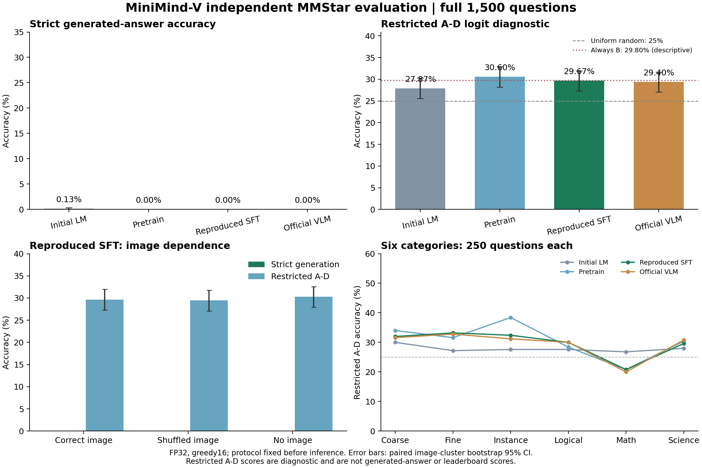

# 独立评测结论

北京时间 2026 年 11 月 3 日 03:43，四个模型、三种图片条件的全部评测完成。共保存 18,000 条 MMStar 预测和 256 条中文算术诊断记录，所有工作进程退出码为 0。评分规则、数据和权重哈希在首次推理前已冻结。

**工程复现已完成；本次外部测试尚未证明 SFT 模型获得可靠的视觉答题增益。**

## 如何理解分数

| 本次 SFT 的指标 | 结果 | 含义 |
|---|---:|---|
| 严格单字母生成 | 0/1,500 | 未遵守固定英文选择题协议的输出格式；官方发布模型同为 0/1,500 |
| 官方 MMStar 前缀解析 | 28/1,500，1.87% | 使用固定版本的官方规则；官方发布模型为 2.00% |
| 强制 A–D 首位置概率诊断 | 445/1,500，29.67% | 强制从四个字母中选择，与实际生成答题不同 |
| 强制诊断中选择 B 的比例 | 1,378/1,500，91.87% | 存在很强的选项偏置 |
| 始终选 B 的描述性参照 | 447/1,500，29.80% | 从测试标签统计得到，用于解释类别不平衡；不是额外训练或调优的模型 |

因此不能用“高于随机均匀选择的 25%”来声称模型有效理解了图片，也不能把 29.67% 写成实际生成问答准确率。官方评分仅按输出前缀提取字母，可能把描述文字的首字母当成选项；完整报告同时保留了严格格式分数。

## 图片是否带来帮助

强制选项诊断：原图 **29.67%**，固定换图 **29.47%**，无图 **30.27%**。

- 原图减换图：**+0.20 个百分点**，按图片聚类的配对 bootstrap 95% 区间 **[-0.87, +1.27]**。
- 原图减无图：**-0.60 个百分点**，区间 **[-1.94, +0.73]**。
- 本次 SFT 减官方发布模型：**+0.27 个百分点**，区间 **[-0.67, +1.25]**。

这些对照没有提供稳定图片增益或超越官方模型的证据。区间只反映这批测试图片的抽样波动，不包含不同训练随机种子的方差。严格生成全部失败时 bootstrap 区间会退化为 [0,0]，不能解读为总体准确率已被确定为零。

## 数据与中文诊断

实际扫描的两份视觉训练源数据共 **4,179,209 行**，未发现测试图片的编码字节或解码 RGB 完全一致的匹配，**58 道题**命中 dHash≤3 的保守近似候选。去除后剩余 **1,442 题**，SFT 的强制选项诊断为 **29.82%**，严格生成仍为 0。分辨率变化、裁切等语义近似及基础模型早期预训练污染仍无法排除；图片筛查不能证明完全无污染。

64 条中文算术题中，四个模型在固定 greedy16 严格数字输出协议下都为 0/64，均达到长度上限。SFT 的标准答案 token NLL 为 7.3529，初始模型为 7.1108。该小样本诊断与长度预算不足以对一般中文能力作结论；中文开放式图片问答体验仍需另设评测。

## 可交付与简历

可以据实描述两阶段全量训练、DDP、恢复验证、权重导出、WebUI 和可追溯独立评测闭环。本阶段适合强调建立可信基线、发现格式遵循和选项偏置问题；能力提升还需后续优化和新的固定评测来验证。

- [完整指标与方法](REPORT.md)
- [协议及模型、数据、代码哈希](protocol.json)
- [机器可读结果和配对区间](summary.json)
- [六个按固定元数据规则抽取的输出例子](EXAMPLES.md)
- [可用于简历的事实表述](简历表述.md)

外部数据来自 [MMStar 官方数据集](https://huggingface.co/datasets/Lin-Chen/MMStar/tree/bc98d668301da7b14f648724866e57302778ab27)，评分参考 [固定版本官方代码](https://github.com/MMStar-Benchmark/MMStar/blob/88f243ab4a39cb339530085c33aecb22819881a1/eval/vlmeval/evaluate/mmstar.py)。这是本项目的外部基准验证，不是独立第三方认证。结果适用于该英文基准和冻结的答题协议。
